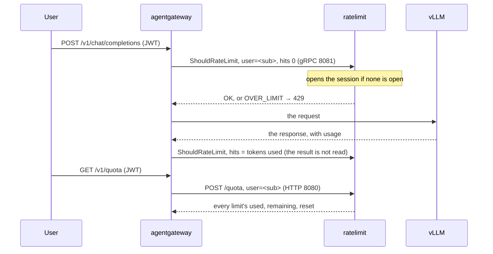

# Example: LLM token quotas behind agentgateway

This example puts the service behind [agentgateway](https://github.com/agentgateway/agentgateway) to give each user Claude-style quotas on a self-hosted model:

- a five-hour session that opens at the user's first message;
- a weekly budget, reset on a day of its own per user;
- a `/v1/quota` route where users read what they have left.

The standalone configuration below was run end to end with agentgateway v1.7.0 and an OpenAI-compatible backend. The Kubernetes form is translated from agentgateway's policy CRD and was not run.

## How the pieces talk



agentgateway sends two decisions per LLM request on a `tokens` descriptor:

1. **A check, before the model is called.** It is enforced: an `OVER_LIMIT` answers the user with `429`, `x-ratelimit-*` headers and `retry-after`. It carries 0 hits, unless agentgateway's tokenization is on and no `cost` is set: then it carries the estimated input tokens.
2. **An amendment, after the response.** It carries the tokens actually used, and agentgateway does not read its result. It is sent after any response, errors included, and when a started stream is dropped. It is **not** sent after a denied check, or when no response was processed: a transport error, a timeout or client disconnect before the response headers, a failed read of a non-streamed body, a response prompt guard. Those requests count no tokens, and hold a [slot](#limiting-requests-in-flight) until its lease.

This only works on an `ai` backend or an `llm` model, as below. On a plain HTTP route, such as a direct `backendRef` to an InferencePool, a `tokens` descriptor is skipped silently, and the user has no limit. The same goes for an `ai` backend's `Passthrough` and `Realtime` routes.

So the limits must count every hit, denied ones included, which is `overflow: envoy`, the default. The session must open on the 0-hit check, which is `open_on: check`, also the default.

## The rate limit configuration

```yaml
# $RUNTIME_ROOT/ratelimit/config/llm.yaml
domain: llm
descriptors:
  - key: user
    rate_limits:
      - name: session
        requests_per_unit: 4000000          # tokens per five-hour session
        window: {type: anchored, duration: 5h}
      - name: weekly
        requests_per_unit: 40000000         # tokens per week
        window: {type: fixed, duration: 7d, offset: hashed}
```

Each value of `user` gets its own session and its own weekly window ([configuration](../configuration.md#windows)). Run the service with Redis, since `anchored` windows need it. Set `RUNTIME_WATCH_ROOT=false` so that edits to the file are reloaded; with a Kubernetes ConfigMap, also set `RUNTIME_IGNOREDOTFILES=true` ([deployment](../deployment.md#kubernetes)):

```sh
RUNTIME_SUBDIRECTORY=ratelimit RUNTIME_WATCH_ROOT=false USE_STATSD=false \
REDIS_SOCKET_TYPE=tcp REDIS_URL=redis:6379 /bin/ratelimit
```

To also cap a whole workspace, add a second descriptor (`key: workspace`) with its own `rate_limits:`, and a second descriptor on the agentgateway side. A request is then denied when either one is over.

## agentgateway, standalone

```yaml
llm:
  port: 4000
  policies:
    jwtAuth:
      mode: strict                          # the default mode, optional, would let requests without a token through
      issuer: https://issuer.example
      audiences: [llm]
      jwks:
        url: https://issuer.example/.well-known/jwks.json
    remoteRateLimit:
      domain: llm
      host: ratelimit:8081                  # gRPC
      descriptors:
      - entries:
        - key: user
          value: jwt.sub                    # CEL: the JWT's subject
        type: tokens                        # amended with llm.totalTokens after the response
  models:
  - name: qwen3
    provider:
      custom:
        formats:
        - type: completions
    params:
      baseUrl: http://vllm:8000/v1
      model: Qwen/Qwen3-32B
binds:
- port: 3000
  listeners:
  - protocol: HTTP
    routes:
    - matches:
      - path:
          exact: /v1/quota
      policies:
        jwtAuth:
          mode: strict
          issuer: https://issuer.example
          audiences: [llm]
          jwks:
            url: https://issuer.example/.well-known/jwks.json
        transformations:
          request:
            set:
              ":method": '"POST"'
              ":path": '"/quota"'
              content-type: '"application/json"'
            body: '{"domain": "llm", "descriptors": [{"entries": [{"key": "user", "value": jwt.sub}]}]}'
      backends:
      - host: ratelimit:8080                # HTTP
```

- **The `/v1/quota` route's descriptors** must match the ones `remoteRateLimit` sends: the same domain, the same keys, and the values from the same claims. Otherwise the lookup reports on other limits ([why](../quota-lookup.md#request)).
- **`failureMode`** defaults to `failClosed`, so requests fail while the service is unreachable. Set `failureMode: failOpen` to let them through instead.
- **A descriptor whose CEL fails is skipped.** If, for example, the token has no `sub`, that request goes unlimited.
- **Negative amendments are not sent.** When agentgateway's tokenization estimates more input tokens than were used, the difference stays counted.

## agentgateway on Kubernetes

The same rate limit, as an `AgentgatewayPolicy`. In this form, an entry is `name` and `expression`, and the descriptor's type is `unit: Tokens`:

```yaml
apiVersion: agentgateway.dev/v1alpha1
kind: AgentgatewayPolicy
metadata:
  name: llm-quotas
spec:
  targetRefs:
    - group: gateway.networking.k8s.io
      kind: Gateway
      name: llm
  traffic:
    rateLimit:
      global:
        backendRef:
          name: ratelimit
          port: 8081
        domain: llm
        descriptors:
          - entries:
              - name: user
                expression: jwt.sub
            unit: Tokens
```

## A smoothed session

A [`token_bucket`](../configuration.md#token_bucket) can stand in for the `anchored` session: a bucket holding about a five-hour session, refilling continuously.

```yaml
      - name: session
        requests_per_unit: 4000000          # refilled in 5 h, and what the bucket holds
        window: {type: token_bucket, duration: 5h}
```

| | `anchored` | `token_bucket` |
|---|---|---|
| At the end of the budget | A wall, then everything back at once when the session ends: everyone who hit it comes back together. | Tokens return continuously: a user who runs out can go on at the refill rate. No cliff at a reset. |
| What users see | "40 %, resets in 2 h 05": a countdown anyone understands. | A level that moves by itself, and a "full in" time that says less. Harder to read and to plan with. |
| Unused budget | Lost when the session ends. | Stops refilling at full: lost too, without a moment to name. |
| An overshoot | The last amendment passes 100 %, and the user waits for the session's end. | The debt, one bucket at most by default, delays the next request by up to 5 h. Lower it with `max_debt`. |

Choose the bucket if your load comes in surges at session resets, and the countdown if users need to plan around a clear limit. It takes under a day to fill: past that, a bucket gets a warning, and a weekly budget stays a `fixed` window.

Leave the local cache off here too: an amendment on a bucket held there is not counted. `/quota` then shows `level`, negative in debt, `used_pct`, and `resets_in_s`, the time until it is full.

## Counting like Claude

By default a `tokens` descriptor counts `llm.totalTokens`. Cached input costs a GPU far less than fresh input, and output far more, so a `cost` can weigh them. Here cached input counts for a tenth, fresh input for 1, and output for 4. These weights are examples, to calibrate against your own hardware:

```yaml
      descriptors:
      - entries:
        - key: user
          value: jwt.sub
        type: tokens
        cost: >-
          int(default(llm.inputTokens, 0)) - int(default(llm.cachedInputTokens, 0))
          + int(default(llm.cachedInputTokens, 0)) / 10
          + 4 * int(default(llm.outputTokens, 0))
```

In an `AgentgatewayPolicy`, the same expression goes in the descriptor's `cost`, next to `unit: Tokens`.

For 1000 tokens of input, 800 of them cached, and 100 of output, this counts 200 + 80 + 400 = 680, where `llm.totalTokens` would count 1100.

- **`llm.inputTokens` includes the cached tokens,** whatever the provider reports, so the subtraction is right for all of them. `llm.providerInputTokens` is the raw figure, which is not.
- **The `int()`s are needed:** token counts are unsigned, and CEL does not mix them with the integers of this expression. `/ 10` truncates.
- **A failing expression skips the descriptor.** The check still passes, the amendment is not counted, and **that user is unlimited on this descriptor**, with only a debug line to say so. So does a negative result. Keep `default()` around every optional field, and watch that `total_hits` still grows.
- **vLLM must run with `--enable-prompt-tokens-details`** to return `cached_tokens`. Without it, nothing is reported as cached, so everything counts as fresh: users are overcharged, and nothing fails.
- **`cached_tokens` can be `null` despite the flag.** It has been reported on some versions, and vLLM's code allows it. `default()` treats it as none, so check that the count really arrives.

**To check it on your deployment,** send the same long prompt twice, streaming with usage included, and read the last chunk's `usage`. The second answer should report `cached_tokens` close to `prompt_tokens`:

```sh
for i in 1 2; do
  curl -sN "$VLLM/v1/chat/completions" -H 'content-type: application/json' -d "{
    \"model\": \"$MODEL\", \"stream\": true, \"stream_options\": {\"include_usage\": true},
    \"messages\": [{\"role\": \"user\", \"content\": \"$LONG_PROMPT\"}]
  }" | grep '\"usage\":{' | tail -1
done
```

## Limiting requests in flight

Volume quotas do not protect a busy GPU node from one harness sending many requests at once. A [`concurrency` window](../configuration.md#concurrency) limits what a user has in flight, per model, so that being limited on one model leaves the others free. It uses a second descriptor, and nothing else changes:

```yaml
# $RUNTIME_ROOT/ratelimit/config/llm.yaml, next to `user`
  - key: inflight_user
    descriptors:
      - key: model
        rate_limits:
          - name: inflight
            requests_per_unit: 8                # a broad safeguard, above what a user needs
            window: {type: concurrency, lease: 10m, retry_after: 2s}
```

Standalone, under `remoteRateLimit`:

```yaml
      descriptors:
      - entries:
        - key: user
          value: jwt.sub
        type: tokens
      - entries:
        - key: inflight_user
          value: jwt.sub
        - key: model
          value: llm.requestModel               # CEL: the model the client asked for
        type: tokens
        cost: '1'                               # required: the check then has 0 hits, the amendment 1
```

On Kubernetes, in the `AgentgatewayPolicy`:

```yaml
        descriptors:
          - entries:
              - name: user
                expression: jwt.sub
            unit: Tokens
          - entries:
              - name: inflight_user
                expression: jwt.sub
              - name: model
                expression: llm.requestModel
            unit: Tokens
            cost: "1"
```

> **`cost: "1"` is what makes this work.** Without a `cost`, a descriptor's check can carry the tokenizer's count, and its amendment the tokens used: the window would release instead of taking slots. Watch `releases_without_slot`, which should stay near 0.

A refused request answers `429` with `retry-after: 2`, unless a longer limit also refuses, and takes nothing from the session's budget. All `tokens` descriptors of a policy go in one call, so a request the session denies takes no slot.

**Slots whose release is lost.** A slot is released by the amendment, so it stays until its `lease` when none comes:

| The request ends with | The slot |
|---|---|
| A response, 5xx included | Released. A flow control TTL eviction answers 503, so it is released. |
| A stream dropped by the model or the client, after it started | Released. |
| A client leaving before the response headers, such as a request cancelled while queued by flow control | **Held until its lease.** |
| A transport error, or `requestTimeout` or `backendRequestTimeout` before the headers | **Held until its lease.** |
| A gateway killed mid-request | **Held until its lease.** |

So expect orphans with flow control, one per cancellation in the queue:

- **Keep the lease short,** around the p99 of request duration. It cannot be renewed: a request that outlives it lets up to two too many in, since its late amendment also releases another's slot. At the p99, that is about 1% of requests.
- **Treat the limit as a broad safeguard,** with room for a few orphans. Fair sharing is the scheduler's job; to feed it, the workspace gateway should overwrite the header the llm-d Router reads with the user's identity (standalone: `transformations.request.set`; `AgentgatewayPolicy`: `transformation`; `x-llm-d-inference-fairness-id: jwt.sub`), never pass the client's on.
- **Watch `slots_expired`**, which counts them. [`docs/upstream/agentgateway-amend-on-drop.md`](../upstream/agentgateway-amend-on-drop.md) proposes sending the amendment on these paths.

**Configure the gateways so that requests get a response:**

- **Workspace gateway:** no `retry` policy, since each attempt takes a slot, and no `requestTimeout` or `backendRequestTimeout` (`timeouts.request` in an `AgentgatewayPolicy`), which end a request without an amendment. `responseIdleTimeout` (`timeouts.responseIdle`) applies once the headers have arrived, so a stuck stream ends with its amendment.
- **Inference gateway:** the timeouts and retries go here. Its 504 or 503 reaches the workspace gateway as a response, which releases the slot.

**`failureMode: failOpen`.** If the check fails and the request goes on, its amendment still releases a slot, one this request never took, and possibly another's. See [several instances, one Valkey](../deployment.md#several-instances-one-valkey).

## What users see

`GET /v1/quota` with the user's token:

```json
{"descriptors":[{"limits":[
  {"limit":4000000,"name":"session","open":true,"quota_mode":false,"remaining":2400000,"resets_at":"2026-10-28T16:05:00Z","resets_in_s":7500,"shadow_mode":false,"used":1600000,"used_pct":40.0,"window":{"duration_s":18000,"type":"anchored"}},
  {"limit":40000000,"name":"weekly","quota_mode":false,"remaining":15200000,"resets_at":"2026-11-02T10:00:00Z","resets_in_s":417600,"shadow_mode":false,"used":24800000,"used_pct":62.0,"window":{"duration_s":604800,"type":"fixed"}}]}],
 "now":"2026-10-28T14:00:00Z"}
```

A client shows it as "Session 40 % · resets in 2 h 05 · Week 62 % · resets Monday 10:00":

- **Percentages:** use `used_pct`. The raw token counts need not be shown.
- **Before the first message:** the session has `open: false` and no reset time.
- **Over 100 %:** `used_pct` can pass 100, because the amendment of the last request is counted even when it overshoots. The next request is then denied until `resets_at`.
- **Leave the local cache off:** with `LOCAL_CACHE_SIZE_IN_BYTES` set, an amendment on a weekly limit already over can be answered from the cache and not counted, so its `used_pct` stops growing. `anchored` sessions are never cached.
- **In flight:** a `concurrency` limit shows `in_flight`, with `limit` and `used_pct`, and no reset: "Requests 2 / 8". To show it, send its descriptor with the user's `model` to `/quota` too.
- **Polling:** poll about once a minute.

Over the limit, the chat request itself answers `429`, with `retry-after` set to the seconds left before the exhausted limit resets (if both are, the later of the two).
